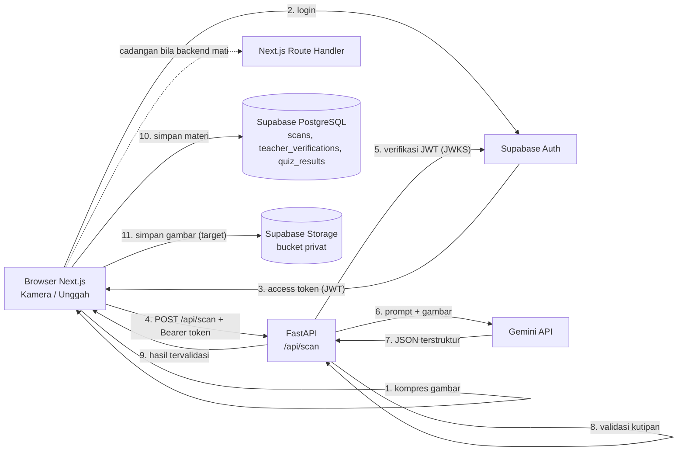

# Arsitektur PahamInklusif AI

Dokumen ini menjelaskan alur data, komponen, dan alasan pilihan teknologi. Acuan fitur ada di [PRD](Archive/PRD%20InkluKids%20AI.md).

## 1. Gambaran Umum

Aplikasi terdiri dari dua layanan:

- **Frontend** — Next.js 15 (App Router, TypeScript) berisi seluruh UI React.
- **Backend** — FastAPI (Python) berisi pemanggilan Gemini, validasi kutipan sumber, cache, dan rate limit.

Gemini **hanya** dipanggil dari backend. Route Handler Next.js (`/api/scan`,
`/api/explain`, `/api/simplify`) dipertahankan sebagai cadangan bila backend
tidak dapat dihubungi, sehingga demo tidak terhenti.

Sejak integrasi Supabase, login dan peran guru/siswa memakai Supabase Auth.
Penyimpanan materi memakai lapisan `Frontend/lib/materials.ts` dengan dua mode
lewat `NEXT_PUBLIC_DATA_MODE`: `local` (default, `localStorage`) atau
`supabase` (tabel `scans`, `teacher_verifications`, `quiz_results`). Bila
Supabase gagal karena jaringan atau mode tamu, lapisan ini kembali ke
`localStorage`. Error otorisasi (401/403/RLS) tidak boleh dianggap sebagai
gangguan jaringan dan harus ditampilkan sebagai pesan.

Status integrasi per 11 November 2026:

- Sudah tersedia: login Supabase, registrasi siswa, profil/role dari tabel
  `profiles`, sinkronisasi materi, verifikasi guru, materi guru + AI, berbagi ke
  siswa, hasil kuis, verifikasi JWT Supabase di backend (`AUTH_MODE=optional`), serta
  skema RPC verifikasi guru (`verify_scan`) di SQL.
- Belum tersedia: antarmuka daftar siswa binaan, pemindaian atas nama siswa,
  dan Supabase Storage untuk gambar permanen (saat ini gambar diproses OCR tanpa disimpan permanen).

Supabase Auth dipakai untuk login guru/siswa. Sinkronisasi database masih
opsional lewat `NEXT_PUBLIC_DATA_MODE`; selama `local`, data tetap di perangkat.

## 2. Alur Fitur 1 (Buku ke Bahasa Sederhana)

1. Pengguna login (Supabase Auth) atau memakai mode tamu lokal.
2. Pengguna memotret atau mengunggah halaman buku.
3. Browser mengompres gambar (maksimal sisi 1200 px, JPEG kualitas 0,82).
4. Browser memanggil `POST /api/scan` di backend dengan `imageBase64`, `mimeType`,
   dan header `Authorization: Bearer <access token>` bila pengguna login.
5. Backend memvalidasi tipe gambar (JPG/PNG/WEBP, dideteksi dari isi file),
   ukuran (maks. 10 MB), rate limit per akun/IP, token Supabase, dan keberadaan
   `GEMINI_API_KEY`.
6. Backend memanggil Gemini dengan prompt dan meminta keluaran JSON terstruktur
   (lihat [AI.md](AI.md)).
7. Setiap `source_quote` dicocokkan dengan `ocr_text` memakai validator yang sama
   dengan frontend (ambang 0,85).
8. Hasil dicache berdasarkan SHA-256 gambar lalu dikembalikan ke browser.
9. Hasil ditampilkan sesuai mode dan disimpan lewat
   `Frontend/lib/materials.ts` (`localStorage` atau Supabase).
10. Gambar diunggah ke Supabase Storage bucket privat (target; saat ini gambar
    hanya diproses untuk OCR dan tidak disimpan permanen).
11. Pengguna dapat membuka kembali materi dari **Materi Saya** tanpa memanggil AI.

## 3. Alur Fitur Lain

| Fitur | Endpoint / Modul | Ringkasan |
|---|---|---|
| Tanya Penjelasan Lain | `POST /api/explain` | Menerima `pointText`, `ocrText`, dan `requestType`; jawaban dibatasi pada teks halaman dan divalidasi |
| Flashcard visual AI | `POST /api/flashcards` | Kata + teks halaman → langkah visual, isyarat teks, contoh kalimat |
| Materi buatan guru + AI | `POST /api/simplify` | Teks guru → poin, glosarium, flashcard; tanpa menambah fakta di luar teks |
| Data contoh | `GET /api/demo` | Materi cadangan untuk demo dan pengujian integrasi |
| Riwayat materi | `Frontend/lib/materials.ts` | Pilih sumber data: Supabase (`NEXT_PUBLIC_DATA_MODE=supabase`) atau `localStorage` (default, maks. 20 materi) |
| Login & peran | `Frontend/lib/auth.tsx` + `LoginModal.tsx` | Supabase Auth; profil dari tabel `profiles`; Mode Guru mengikuti role |
| Registrasi siswa | `Frontend/lib/auth.tsx` + `LoginModal.tsx` | Tersedia: `signUp` Supabase, role selalu `siswa` |
| Penyimpanan gambar | `Frontend/lib/storage.ts` (rencana) | **Direncanakan:** bucket privat `scans`, path `{user_id}/{scan_id}.jpg`, signed URL |
| Verifikasi JWT | `Backend/app/security.py` + `Frontend/lib/api-client.ts` | Tersedia: JWKS Supabase (ES256/RS256), `aud`, `exp`; `AUTH_MODE=optional`; rate limit per akun |
| Mode Belajar | `Frontend/app/page.tsx` | Satu hasil scan disajikan dalam Mode Baca, Visual, atau Suara tanpa memanggil AI |
| Text-to-Speech | Web Speech API | `speechSynthesis` Bahasa Indonesia |
| Pencarian suara | `Frontend/app/components/HistoryView.tsx` | `SpeechRecognition` id-ID (Chrome/Edge) + input ketik |
| Mode Guru / verifikasi | `Frontend/app/components/TeacherModeView.tsx` | Guru/pendamping membandingkan poin AI dengan teks OCR, menyunting poin, lalu menandai materi terverifikasi. Didukung RPC `verify_scan` (dengan fallback direct update) |
| Kuis Ceria | `Frontend/app/components/QuizModal.tsx` | Soal pilihan ganda disusun lokal dari `points` (tanpa memanggil AI) |
| Materi Kelas (guru) | `Frontend/app/components/CreateMaterialModal.tsx` | Guru menulis teks, AI menyederhanakan, guru menyunting poin, lalu membagikan ke semua siswa binaan (salinan per siswa) |

## 4. Komponen

| Komponen | Tanggung jawab |
|---|---|
| `Frontend/app/page.tsx` | Layar utama, pemilih mode, kartu poin, tutor, riwayat, pengaturan aksesibilitas, toggle Mode Guru, pembuka kuis |
| `Frontend/app/components/HistoryView.tsx` | Riwayat materi, pencarian suara/ketik, badge verifikasi guru dan skor kuis |
| `Frontend/app/components/TeacherModeView.tsx` | Panel verifikasi guru: teks OCR vs poin AI, edit poin/analogi, catatan, cap verifikasi |
| `Frontend/app/components/CreateMaterialModal.tsx` | Guru membuat materi dari teks, bantuan AI, edit poin, simpan/bagikan ke siswa |
| `Frontend/app/components/QuizModal.tsx` | Kuis pilihan ganda lokal, umpan balik, skor, dan pengulangan |
| `Frontend/app/components/ScanModal.tsx` | Unggah, kamera, kompresi, data contoh, indikator proses |
| `Frontend/lib/api-client.ts` | Pemanggil backend + fallback ke Route Handler |
| `Frontend/app/api/scan/route.ts` | Cadangan: validasi input, panggil Gemini, validasi kutipan |
| `Frontend/app/api/explain/route.ts` | Cadangan: panggil Gemini untuk penjelasan alternatif |
| `Frontend/lib/gemini.ts` | Klien Gemini dan prompt untuk route handler cadangan |
| `Frontend/lib/source-validator.ts` | Normalisasi teks dan validasi kutipan |
| `Frontend/lib/materials.ts` | Lapisan data materi: Supabase + fallback `localStorage`, verifikasi guru, hasil kuis |
| `Frontend/lib/auth.tsx` | Provider sesi Supabase, profil, role, login/logout |
| `Frontend/app/components/LoginModal.tsx` | Form masuk email/password; rencana mode daftar siswa |
| `Frontend/lib/supabase.ts` | Klien Supabase (anon key), validasi env, lazy init |
| `Frontend/lib/storage.ts` (rencana) | Unggah/hapus gambar ke bucket privat dan membuat signed URL |
| `Frontend/lib/history.ts` | Implementasi `localStorage` yang dipakai mode lokal |
| `Frontend/lib/seed-data.ts` | Data contoh untuk demo |
| `Backend/app/main.py` | FastAPI, CORS, security header, exception handler |
| `Backend/app/deps.py` | Rate limit (per akun/IP), cache, helper hash |
| `Backend/app/security.py` | Verifikasi token Supabase (JWKS/HS256) dan dependency `require_user` |
| `Frontend/lib/server-rate-limit.ts` | Rate limit per IP untuk Route Handler cadangan Next.js |
| `Backend/app/routers/scan.py` | Endpoint scan, validasi gambar, cache |
| `Backend/app/routers/simplify.py` | Endpoint penyederhanaan teks materi guru |
| `Backend/app/routers/explain.py` | Endpoint AI tutor + fallback tanpa API key |
| `Backend/app/routers/flashcards.py` | Endpoint flashcard visual |
| `Backend/app/services/gemini.py` | Klien Gemini, prompt, retry |
| `Backend/app/services/source_validator.py` | Validasi kutipan (port dari TypeScript) |
| `Backend/app/services/cache.py` | Cache TTL berbasis hash gambar |
| `Backend/app/services/rate_limit.py` | Rate limit sliding window (kunci per akun atau IP) |

## 5. Keputusan Teknis

| Keputusan | Alasan |
|---|---|
| Frontend Next.js dan backend FastAPI terpisah | Sesuai PRD; API key dan validasi berada di server Python, UI tetap ringan |
| Frontend tetap punya Route Handler cadangan | Demo Grand Final tidak berhenti bila backend belum dijalankan |
| Gemini dari backend | API key tidak terekspos dan input dapat divalidasi |
| Structured output (JSON) | Hasil mudah divalidasi dan ditampilkan per mode |
| Validasi kutipan di server | Mengurangi halusinasi dan menjadi dasar Lihat Sumber |
| Riwayat di `localStorage` (default) | Demo tetap berjalan tanpa akun/database; dapat dibuka ulang tanpa AI |
| Supabase Auth + profil | Login dan role dibaca dari tabel `profiles`, bukan dari state frontend; guru/siswa dipisahkan RLS |
| RLS di semua tabel | Siswa hanya data sendiri; guru hanya siswa binaan; guru tidak punya `UPDATE scans` bebas |
| Verifikasi guru lewat alur verifikasi | Perubahan poin siswa hanya melalui RPC/transaksi yang memeriksa `guardianships` |
| Supabase Storage (rencana) | Gambar tidak disimpan sebagai base64 di database; bucket privat + signed URL |
| JWT di backend | Endpoint AI tidak dapat dipanggil dengan token palsu; tamu mengikuti `AUTH_MODE` |
| Verifikasi guru & skor kuis | Mode lokal menyimpan perangkat; mode Supabase menyinkronkan lewat `scans`, `teacher_verifications`, `quiz_results` dengan RLS |
| Kompresi gambar di klien | Menghemat bandwidth dan mempercepat unggahan |
| Cache hash + rate limit di memori | Cukup untuk satu proses demo; mudah diganti Redis saat produksi |

## 6. Keamanan

- `GEMINI_API_KEY` hanya di environment backend (atau Route Handler cadangan);
  tidak pernah dikirim ke browser dan tidak dikomit.
- Input divalidasi di server: tipe string, MIME gambar, ukuran gambar, panjang
  teks, nilai enum `requestType`.
- CORS dibatasi pada `localhost:3000` dan domain Vercel; header `Authorization`
  diizinkan untuk membawa token Supabase.
- Pesan error ke pengguna bersifat umum; log tidak memuat isi gambar atau teks.
- Supabase Auth dipakai untuk login siswa/guru. Role dibaca dari tabel
  `profiles`; pendaftaran publik hanya membuat akun siswa.
- Frontend hanya memakai anon/publishable key. `service_role` tidak boleh ada di
  frontend maupun di variabel `NEXT_PUBLIC_*`.
- RLS wajib aktif di semua tabel: siswa hanya data miliknya, guru hanya data
  siswa yang terhubung di `guardianships`.
- Klien hanya boleh mengubah `name`, `grade`, dan `accessibility_settings` pada
  profilnya sendiri. Trigger `prevent_profile_role_change` + izin kolom menolak
  perubahan `role` dari klien (lihat `Docs/SQL-security-hardening.sql`).
- Guru tidak boleh `UPDATE scans` secara langsung. Perubahan poin siswa hanya
  lewat alur verifikasi (RPC `verify_scan`/setara) yang memeriksa relasi guru-siswa.
- Endpoint AI memverifikasi token Supabase (JWKS ES256/RS256, `aud`, `exp`).
  `AUTH_MODE=optional` menolak token palsu/kedaluwarsa namun tetap mengizinkan
  tamu untuk demo; `required` mewajibkan login. Rate limit dihitung per akun.
- Gambar akan disimpan di bucket privat dengan signed URL (target Storage).
  Saat ini gambar hanya diproses untuk OCR dan tidak disimpan permanen.
- Riwayat dapat dihapus pengguna dari antarmuka; data Supabase mengikuti RLS dan
  hak hapus akun.

## 7. Mode Penjalanan

| Lingkungan | Cara | Catatan |
|---|---|---|
| Pengembangan | `uvicorn` di `Backend` + `npm run dev` di `Frontend` | Frontend memanggil `http://localhost:8000`; isi env Supabase di `Frontend/.env.local` |
| Submission | Vercel (root `Frontend`) + hosting backend | Atur `NEXT_PUBLIC_API_BASE_URL`, `NEXT_PUBLIC_SUPABASE_URL`, `NEXT_PUBLIC_SUPABASE_ANON_KEY`, `NEXT_PUBLIC_DATA_MODE`, dan `GEMINI_API_KEY` di dashboard. Backend: `GEMINI_API_KEY`, `SUPABASE_URL`, `AUTH_MODE` |
| Grand Final | `uvicorn` + `npm run dev` di localhost | Data contoh tersedia sebagai cadangan; mode `local` tetap bisa dipakai tanpa Supabase |

## 8. Batasan dan Pengembangan Lanjutan

Supabase Auth sudah dipakai untuk login guru/siswa. **Fase 1.5 (guru)** sudah
tersedia sebagian: verifikasi tersinkron, materi guru + AI, berbagi ke siswa,
dan hasil kuis. **Belum tersedia:** antarmuka daftar siswa binaan dan pemindaian
atas nama siswa. Registrasi siswa, file SQL skema lengkap, dan verifikasi JWT di
FastAPI sudah tersedia. Penguatan yang masih dikerjakan: Supabase Storage, RPC
verifikasi guru, dashboard admin, dan cache lintas proses.
Sinkronisasi materi/verifikasi/kuis tersedia lewat
`NEXT_PUBLIC_DATA_MODE=supabase`, tetapi default proyek tetap `local` agar demo
stabil. Lihat [Backend README](../Backend/README.md) dan
[PRD](Archive/PRD%20InkluKids%20AI.md).
